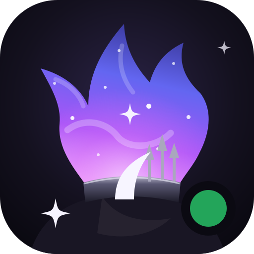

<p align="center"></p>

# Discord-PULSE

**PULSE** is the Profile User Live Status Engine: Discord presence cards for GitHub profile READMEs and a live card for websites, maintained by [LianHarman(LienThuan04)](https://github.com/LienThuan04). Sixteen themes for GitHub profile READMEs and a live card for websites.

<p align="center">
  
  
</p>

Show activities, Spotify, custom status, devices, avatar decorations, nameplates, server tags, display-name styles and public badges. Add eight style axes, dark/light modes, vivid profile effects and collectible frames. The bundled previews use sanitized fixtures; your card uses your public presence and profile.

**Production:** the hosted deployment is `https://discord-pulse-lian.vercel.app`. Self-hosters replace that origin with their own.

## Quick start

1. Join [Lanyard](https://discord.gg/lanyard) so it can monitor your Discord presence.
2. Enable Discord **Settings → Advanced → Developer Mode**, then right-click your profile and choose **Copy User ID**.
3. Open [Card Studio](https://discord-pulse-lian.vercel.app), enter your ID, choose a theme and copy Markdown, HTML, Picture, Live iframe or SVG URL. Or replace `YOUR_DISCORD_ID` below:

```markdown
[](https://discord.com/users/YOUR_DISCORD_ID)
```

## Theme gallery

Every theme supports dark and light. These are self-contained SVG snapshots, available before deployment. See the [dark/light gallery](https://github.com/LienThuan04/Discord-Github-Profile/wiki#dark-and-light-previews), [all example variants](public/examples/index.html) and [style gallery](public/examples/styles/index.html).

| Theme | Preview |
|---|---|
| `profile` · discord profile popout |  |
| `nitro` · bold color and glowing avatar |  |
| `member` · member-list row |  |
| `compact` · slim presence strip |  |
| `activity` · current activity and artwork |  |
| `glass` · frosted panels |  |
| `badge` · tiny presence pill |  |
| `chat` · discord message and embeds |  |
| `banner` · wide identity banner |  |
| `terminal` · command-line presence |  |
| `neon` · glowing panels |  |
| `retro` · pixel game interface |  |
| `polaroid` · still photo and caption |  |
| `mobile` · lock-screen notifications |  |
| `voice` · voice-channel tile |  |
| `wave` · nameplate header and a liquid activity panel |  |
| **Coming soon** · more themes in development | Have an idea? [Suggest a theme](https://lianharman.netlify.app) |

## Options

The same 37 snake_case options work on `/api/{id}` and `/live/{id}` where the theme supports them. Studio offers the relevant controls and omits defaults from copied URLs. Unknown keys are ignored; repeated keys use the first value; invalid fields fall back independently. Numbers are rounded and clamped. Booleans are exactly `true` or `false`; style values and `banner_source` also accept surrounding whitespace and mixed case.

<details>
<summary>Every parameter, accepted value and default</summary>

| Parameter | Accepted values | Default | Effect |
|---|---|---|---|
| `theme` | `profile`, `nitro`, `member`, `compact`, `activity`, `glass`, `badge`, `chat`, `banner`, `terminal`, `neon`, `retro`, `polaroid`, `mobile`, `voice`, `wave` | `profile` | Card layout |
| `mode` | `dark`, `light` | `dark` | Appearance |
| `accent` | 3, 6 or 8 hex digits; optional `#` | `5865f2` | Accent; this default allows valid KV `accent` to take precedence |
| `bg` | Hex color or `transparent` | Automatic (`null` internally) | Theme background; overlays can remain visible |
| `radius` | Number, 0–48px | `16` | Outer radius where supported; badge caps it at 16px |
| `width` | Number, 300–600px; banner 600–1000px | `420`; banner `800` | Card body width before responsive scaling; member/mobile/polaroid apply their own clamps; badge sizes itself |
| `animated` | `true`, `false` | `true` | Supported motion/assets; SVG nameplates and profile effects use still art; polaroid is always static |
| `max_activities` | Number, 1–4 | `2` | Non-Spotify activity count on layouts with multiple sections; Spotify is separate |
| `idle_text` | Trimmed nonempty text, at most 120 characters | `Enjoying a quiet moment` | Idle message |
| `name_gradient` | 2–8 hex colors separated by `-` | `[]` (no custom gradient) | Custom name gradient; native Discord colors win unless forced |
| `force_gradient` | `true`, `false` | `false` | Let a valid custom gradient override native name colors |
| `show_banner` | `true`, `false` | `true` | Enable the KV banner override when `hide_kv=false`; other banner tiers still apply |
| `hide_decoration` | `true`, `false` | `false` | Hide avatar decoration |
| `hide_nameplate` | `true`, `false` | `false` | Hide nameplate artwork; other banner tiers still apply |
| `hide_tag` | `true`, `false` | `false` | Hide guild/server tag |
| `hide_badges` | `true`, `false` | `false` | Hide merged public-flag and profile badges |
| `hide_status` | `true`, `false` | `false` | Hide status indicators and status wording where supported |
| `hide_platforms` | `true`, `false` | `false` | Hide desktop/web/mobile/console/VR indicators |
| `hide_custom_status` | `true`, `false` | `false` | Hide custom-status text and emoji |
| `hide_activity` | `true`, `false` | `false` | Hide non-Spotify activities; summaries use the next visible source |
| `hide_spotify` | `true`, `false` | `false` | Hide Spotify content |
| `hide_timestamps` | `true`, `false` | `false` | Hide activity clocks and progress bars |
| `hide_kv` | `true`, `false` | `false` | Hide bio/About Me and pronouns from KV and profile, KV location/website and the KV banner; KV accent remains independent |
| `avatar_shape` | `circle`, `squircle`, `square`, `hexagon`, `octagon` | `circle` | Avatar silhouette |
| `ring` | `status`, `none`, `accent`, `gradient`, `rainbow`, `glow`, `pulse`, `dashed`, `double` | `status` | Avatar ring; visible decorations suppress line rings and soften halo rings |
| `pattern` | `none`, `dots`, `grid`, `diagonal`, `waves`, `stars`, `circuit`, `confetti`, `bubbles`, `aurora`, `noise`, `hex` | `none` | Background pattern |
| `effect` | `none`, `float`, `shimmer`, `glow`, `scanline`, `sparkle` | `none` | Decorative style effect, independent of Discord profile effects |
| `status_style` | `dot`, `pill`, `text`, `ring` | `dot` | Presence indicator; ring falls back to dot with a visible decoration |
| `eq_style` | `bars`, `wave`, `pulse`, `dots`, `line`, `blocks`, `mirror`, `circle`, `spectrum`, `none` | `bars` | Equalizer beside Spotify or Listening titles |
| `font` | `default`, `rounded`, `mono`, `serif`, `condensed`, `display` | `default` | System font stack; explicit choices override native name fonts |
| `border` | `subtle`, `none`, `accent`, `gradient`, `glow` | `subtle` | Card border |
| `banner_source` | `auto`, `profile`, `nameplate`, `accent`, `none` | `auto` | Banner family; `auto` tries KV → profile image → Nitro colors → banner color → nameplate → accent (member prefers nameplate) |
| `hide_effect` | `true`, `false` | `false` | Hide the Discord profile effect, independently of the `effect` style |
| `hide_frame` | `true`, `false` | `false` | Hide the collectible frame; otherwise its overflow grows the output canvas |
| `tz` | Named IANA time zone, e.g. `Asia/Ho_Chi_Minh` | `UTC` | Chat/mobile clock and polaroid date; invalid zones and numeric offsets fall back to UTC; Studio initially uses the browser zone |
| `wave_color` | `auto` or an opaque RGB hex color | `auto` | Wave theme's liquid panel. `auto` matches the running app: Spotify green, a known app's brand color, else a blurred, saturated wash of the activity art; idle uses the profile banner color, then the accent. Text is white like the original card and switches to black on light colors |
| `ignore_app_id` | Up to 10 comma-separated application IDs (snowflakes) | empty | Drop activities from these applications before any theme renders them |

</details>

Hex colors accept 3, 6 or 8 digits (alpha included), optionally prefixed with `#`; omit it in URLs or encode it as `%23`. Profile frame overflow grows the image beyond `width`, which describes the underlying card. [Theme sizes and style support](https://github.com/LienThuan04/Discord-Github-Profile/wiki#themes).

### Old card URLs

Queries from the owner's previous card keep working when only the domain changes. Old keys are read only when present, and new keys always win:

| Old key | Maps to |
|---|---|
| `theme=dark` / `theme=light` | `theme=wave` with that `mode` |
| `imgStyle=circle\|square` | `avatar_shape` |
| `animatedDecoration` | `animated` |
| `showBanner=true\|animated\|false` | Header art on (animated) or `banner_source=none` |
| `hideDecoration`, `hideStatus`, `hideActivity`, `hideSpotify`, `hideBadges` | The matching `hide_*` option |
| `forceGradient` | `force_gradient` |
| `ignoreAppId` | `ignore_app_id` |
| `showDisplayName` | Ignored; display names are always shown |

## README snapshot and live card

`/api/{id}` returns a self-contained SVG snapshot for README images. Its clocks can advance with CSS, but new status, song or activity data requires a fresh image request and is subject to GitHub Camo caching.

`/live/{id}` updates through Lanyard's WebSocket. Copy Studio's **Live iframe** for a website: its `dgp:height` message reports the scaled canvas height, including frame overflow. The parent must validate both `event.origin` and `event.source === frame.contentWindow`, then accept only finite heights greater than 0 and less than 10,000px. See the [complete iframe example](https://github.com/LienThuan04/Discord-Github-Profile/wiki#iframe-and-auto-resize). GitHub READMEs do not run iframe scripts.

## Profile data and privacy

Lanyard supplies presence, activities, Spotify, exposed cosmetics and public KV. The optional, **unofficial** `dcdn.dstn.to` mirror supplies profile bio/pronouns, banner colors, Nitro colors, effect/frame identifiers and extra badges. Public Discord `collectibles-products/{sku}` lookups resolve effect and frame artwork. An optional server-only `DISCORD_BOT_TOKEN` adds the official Discord user lookup for banner and accent color. Cards still render when these sources fail.

**Keeping your frame and effect.** Discord gives apps no access to profile effects or frames, so the card resolves them in this order:
1. The mirror's current answer.
2. Your own Lanyard KV keys `profile_effect` and `profile_frame` (a SKU, or `none`). Card Studio shows the exact `/set` commands.
3. The last good profile the server saved. This needs an optional Upstash Redis store (`KV_REST_API_URL`/`KV_REST_API_TOKEN` or `UPSTASH_REDIS_REST_URL`/`UPSTASH_REDIS_REST_TOKEN`).

With the store, cold starts and mirror outages no longer drop the frame and effect.

`DISCORD_PROFILE_PROVIDER=dstn` is the default; set it to `off` to disable the mirror, or use `DISCORD_PROFILE_PROVIDER_URL` for a compatible mirror. The mirror receives requested user IDs and is independent of Discord and this project. Keep bot tokens server-side; no user token is needed. [Sources and environment variables](https://github.com/LienThuan04/Discord-Github-Profile/wiki#profile-extras-and-privacy).

**Privacy:** the card shows what your public Discord profile and whitelisted Lanyard KV expose. `hide_kv=true` hides About Me/bio and pronouns from both sources, KV location/website and the KV banner. Other artwork has separate controls (`banner_source`, `hide_effect`, `hide_frame`); `hide_kv` is a display setting, not access control for the public sources.

## Deploying to Vercel

1. Import this repository as a new Vercel project using the Next.js preset and repository root.
2. Use the pinned Node.js `24.x` and `pnpm@11.22.0`. Set Vercel's `ENABLE_EXPERIMENTAL_COREPACK=1` to honor `packageManager`, then install with `pnpm install --frozen-lockfile` and build with `pnpm build` (use `pnpm.cmd` on Windows). See [Vercel Corepack setup](https://vercel.com/docs/builds/configure-a-build#corepack).
3. Keep the default public Lanyard URLs, configure optional profile variables from [.env.example](.env.example), set `NEXT_PUBLIC_SITE_URL` to your public HTTPS origin or leave it empty for the request origin, and optionally set `FEEDBACK_URL` to where Studio's feedback links should go (default: the owner's GitHub profile).
4. Deploy, set the production origin (`https://discord-pulse-lian.vercel.app` or your own), and test Studio, an SVG image and a live iframe. The SVG must be publicly reachable without a login page. Redeploy after environment changes. Follow the [Vercel guide](https://github.com/LienThuan04/Discord-Github-Profile/wiki#deploying-to-vercel).

## Deploying to Cloudflare Workers

The repository also deploys to Cloudflare Workers through [OpenNext](https://opennext.js.org/cloudflare), configured by [wrangler.jsonc](wrangler.jsonc) and [open-next.config.ts](open-next.config.ts). Import the repository in Workers & Pages as a Worker named `discord-pulse`, then set the build command to `pnpm exec opennextjs-cloudflare build` and the deploy command to `pnpm exec opennextjs-cloudflare deploy`. Runtime values live in `wrangler.jsonc` `vars`; add `DISCORD_BOT_TOKEN` as a Secret if you use one. Workers Free allows 10 ms of CPU per request, which SVG rendering can exceed. [docs/DEPLOY-CLOUDFLARE.md](docs/DEPLOY-CLOUDFLARE.md) is the full checklist for any Next.js app, with every error met so far and its fix.

## Documentation

| Page | Contents |
|---|---|
| [Card Studio](https://github.com/LienThuan04/Discord-Github-Profile/wiki#card-studio) | Build, preview and share a card |
| [Themes](https://github.com/LienThuan04/Discord-Github-Profile/wiki#themes) | All 16 layouts, sizes and dark/light previews |
| [Style axes](https://github.com/LienThuan04/Discord-Github-Profile/wiki#style-axes) | Shapes, rings, patterns, effects, status, equalizer, fonts and borders |
| [Options](https://github.com/LienThuan04/Discord-Github-Profile/wiki#options) | All parameters and defaults |
| [Profile extras and privacy](https://github.com/LienThuan04/Discord-Github-Profile/wiki#profile-extras-and-privacy) | Data sources, environment and visibility |
| [Lanyard KV](https://github.com/LienThuan04/Discord-Github-Profile/wiki#lanyard-kv) | Set bio, pronouns, banner and metadata |
| [Development](https://github.com/LienThuan04/Discord-Github-Profile/wiki#development) | Local setup, tests and deterministic fixture examples |

## Feedback and ideas

More themes and features are still in development. Have an idea for a theme, a missing Discord detail or a new feature? Send it to me on [my website](https://lianharman.netlify.app) or through [my GitHub profile](https://github.com/LienThuan04). Card Studio links there too: the **Coming soon** tile and **Suggest a theme or feature** in the footer.

## Contributing

Development setup and verification are in the [Wiki](https://github.com/LienThuan04/Discord-Github-Profile/wiki#development). Implementation is original; cnrad/lanyard-profile-readme and kyrie25/lanyard-profile-readme inspired the project. Presence data comes from Lanyard.

## Icon

The app icon ([public/brand/icon.svg](public/brand/icon.svg), also the favicon `src/app/icon.svg` and Card Studio's logo) is original artwork inspired by the owner's avatar: a cosmic purple flame rising from a spiked collar, with four-point sparkles. A green presence dot marks the Discord app. It does not reproduce Discord's logo or any other product's mark.

## License

MIT · Copyright (c) 2026 LianHarman(LienThuan04). See [LICENSE](LICENSE).
